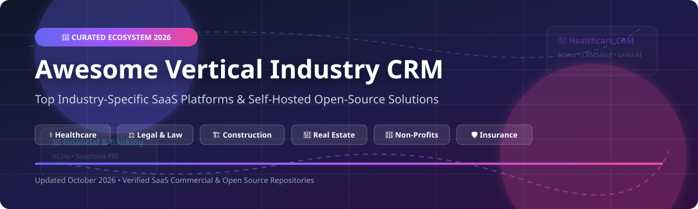

  

# 🚀 Awesome Vertical Industry CRM 🏢

  
  
  
  
  

## 🌟 Top Vertical Industry CRM Ecosystem & Software Solutions

> **A Curated List of Industry-Specific Commercial SaaS Platforms & Open-Source Self-Hosted GitHub Projects**  
> *Focused on Niche CRM, Specialized Workflow Automation, Healthcare, Finance, Real Estate, Legal, Construction & Self-Hosted Industry Solutions.*  
> 📅 **Last updated: October 2026**

---

## 💡 Overview & SEO Keywords

Welcome to the definitive **Awesome Vertical Industry CRM** resource list! As businesses shift away from generalist, "one-size-fits-all" CRM platforms, specialized industry-tailored CRMs provide domain-specific data models, out-of-the-box compliance (HIPAA, GLBA, GDPR), and custom operational workflows.

This list aggregates top **enterprise SaaS platforms** (Salesforce Industries, Veeva, Guidewire, nCino) and **open-source self-hosted repositories** across healthcare, legal, real estate, construction, insurance, travel, education, and non-profit sectors.

---

## 📋 Table of Contents

- [☁️ SaaS / Commercial Platforms](#️-saas--commercial-platforms)
- [💻 Open-Source GitHub Projects](#-open-source-github-projects)
  - [⚡ Top Ranked Repositories (Sorted by Star Count)](#-top-ranked-repositories-sorted-by-star-count)
  - [🏢 Vertical Industry Categories](#-vertical-industry-categories)
- [📈 Star History](#-star-history)
- [💖 Support & Sponsorship](#-support--sponsorship)
- [🤝 How to Contribute](#-how-to-contribute)
- [⚠️ Disclaimer](#️-disclaimer)

---

## ☁️ SaaS / Commercial Platforms

The global CRM market is projected to reach **$86.4 billion to $126.2 billion in 2026** (with the broader vertical software sector estimated at **$164 billion**). The vertical CRM sector is **moderately fragmented**, experiencing a structural shift away from generalist "winner-take-all" suites toward specialized, industry-tailored platforms that deliver faster time-to-value and domain-specific workflows.

| Product | Industry Focus & Overview | Company Size (Valuation / Revenue) | Starting Tier Pricing | Free Tier / Trial Limits |
| :--- | :--- | :--- | :--- | :--- |
| **[Salesforce Industries Cloud](https://www.salesforce.com/)** | **Salesforce's vertical CRM suite** — tailored solutions for financial services, healthcare, manufacturing, communications, and more. Best for enterprises wanting vertical CRM on a unified platform. | **$187B Market Cap** ($41.5B FY26 Revenue) | **$150/user/month** (Financial Services Cloud Professional Edition) | **30-day free trial** (Full-featured pre-configured or empty org trial) |
| **[Veeva Systems](https://www.veeva.com/)** | **Life sciences industry cloud** — CRM, regulatory, quality, and clinical solutions for pharma and biotech. The de facto standard for life sciences commercial operations. | **$27.6B Market Cap** ($2.75B FY25 Revenue) | **$140/user/month** (Vault CRM estimated starting tier) | **SiteVault Free Plan** (Free for clinical sites managing <= 20 active studies) |
| **[Toast POS](https://pos.toasttab.com/)** | **Restaurant point-of-sale and management platform** — POS, online ordering, and restaurant CRM. Best for restaurants. | **$17.5B Market Cap** ($1.91B TTM Revenue) | **$0/month** (Pay-As-You-Go Starter Plan; processing fees ~3.09% + $0.15) | **No free trial** (Pay-as-You-Go plan available with $0 base monthly software fee) |
| **[Guidewire](https://www.guidewire.com/)** | **Property and casualty insurance platform** — policy, billing, and claims management. Best for P&C insurers. | **$12.8B Market Cap** ($1.48B TTM Revenue) | **Custom annual subscription** (Indexed to Direct Written Premium, typical enterprise contracts) | **No free trial** (Guided enterprise product demos available upon request) |
| **[Procore](https://www.procore.com/)** | **Construction management platform** — project management, quality, safety, and financials. Best for construction CRM and operations. | **$8.3B Market Cap** ($1.42B TTM Revenue) | **Custom annual fee** (Based on Annual Construction Volume / ACV) | **No free trial** (Custom interactive sales demo upon request) |
| **[ServiceTitan](https://www.servicetitan.com/)** | **Field service management platform** — CRM, dispatch, and operations for HVAC, plumbing, and electrical contractors. Best for home services. | **$6.5B Valuation** ($1.06B TTM Revenue) | **Custom subscription** (Based on technician count or committed annual revenue) | **No free trial** (Free online company valuation calculator & custom demo) |
| **[Amdocs](https://www.amdocs.com/)** | **Communications and media industry software** — CRM, billing, and operations for telecom and media providers. Best for telecom CRM. | **$6.13B Market Cap** ($4.65B TTM Revenue) | **Custom multi-year enterprise quote** (Scaled by subscriber volume and deployed modules) | **No free trial** (Enterprise proof-of-concept / sandbox environments for partners) |
| **[Blackbaud](https://www.blackbaud.com/)** | **Nonprofit and education software** — CRM, fundraising, and financial management. Best for nonprofits and educational institutions. | **$2.0B Market Cap** ($1.15B TTM Revenue) | **Custom subscription quote** (Based on donor base size, organization type, and module tier) | **No free trial** (Personalized product walkthrough and consultation upon request) |
| **[nCino](https://www.ncino.com/)** | **Cloud banking platform** — loan origination, onboarding, and portfolio management. Best for commercial banks and credit unions. | **$1.98B Market Cap** ($594.8M FY26 Revenue) | **Custom enterprise licensing** (Scoped per institution based on asset size and modules) | **No free trial** (Custom institutional demo upon request) |
| **[Insurity](https://www.insurity.com/)** | **Insurance software solutions** — policy, billing, claims, and analytics for P&C insurers. Best for insurance carriers. | **Private (~$250M Est. Revenue)** | **Custom subscription tiers** (Bespoke carrier pricing per policy volume & module) | **No free trial** (Personalized product demonstration upon request) |

---

## 💻 Open-Source GitHub Projects

Below is a curated list of top open-source vertical CRM repositories. All projects are sorted by **GitHub Star Count (descending)**, with social star badges linking directly to each repository's stargazers page.

### ⚡ Top Ranked Repositories (Sorted by Star Count)

1. **[Twenty CRM](https://github.com/twentyhq/twenty)**   
   🏢 **Modern Open-Source AI-Native CRM**, Apache-2.0 licensed (~58,100+ stars). Self-hosted alternative to Salesforce with customizable data models, enterprise extensibility, and vertical workflow triggers.

2. **[Dolibarr ERP/CRM](https://github.com/Dolibarr/dolibarr)**   
   🏪 **Modular ERP & Vertical CRM**, GPL-3.0 licensed (~7,700+ stars). Modular architecture with dedicated vertical extensions for non-profit foundations, point-of-sale (POS), healthcare clinics, manufacturing, and international multi-tax billing.

3. **[SuiteCRM](https://github.com/salesagility/SuiteCRM)**   
   🏗️ **Enterprise Vertical CRM**, AGPL-3.0 licensed (~7,200+ stars). Highly customizable for construction bidding, subcontractor management, manufacturing pipelines, and field service management.

4. **[EspoCRM](https://github.com/espocrm/espocrm)**   
   📊 **Flexible Open-Source CRM**, GPL-3.0 licensed (~7,200+ stars). Designed for easy customization across real estate, e-commerce, legal, and financial services.

5. **[Frappe CRM](https://github.com/frappe/crm)**   
   ⚡ **Modern Open-Source Vertical CRM**, GPL-3.0 licensed (~3,800+ stars). Built on the Frappe framework for seamless integration with ERPNext vertical modules (healthcare, education, agriculture).

6. **[Krayin CRM](https://github.com/krayin/laravel-crm)**   
   🚘 **Laravel Omni-Channel CRM**, MIT licensed (~2,800+ stars). Tailored for automotive, hospitality, and retail banking with built-in email, chat, and lead routing.

7. **[CiviCRM](https://github.com/civicrm/civicrm-core)**   
   🤝 **De Facto Non-Profit & Civic CRM**, AGPL-3.0 licensed (~2,600+ stars). Over 20 years of development powering thousands of NGOs worldwide with donor management, advocacy campaigns, and event tracking.

8. **[Cordys CRM](https://github.com/1Panel-dev/CordysCRM)**   
   🤖 **AI-Native Lead-to-Cash CRM**, GPL-3.0 licensed (~500+ stars). Features automated lead assignment, AI contract quoting, and integrated data analytics.

9. **[RealEstateCRM](https://github.com/prolinkinfo/RealEstateCRM)**   
   🏠 **MERN Stack Real Estate CRM**, MIT licensed (~25+ stars). Specialized client management, property tracking, and deal pipeline for real estate agents.

10. **[InsurancePro CRM](https://github.com/prolinkinfo/InsuranceProCRM)**   
    🛡️ **Insurance Agent CRM**, Open-source (~21+ stars). Streamlined lead and policy management built specifically for independent insurance brokers.

11. **[LexManager](https://github.com/felCardoso/LexManager)**   
    ⚖️ **Legal Office CRM**, MIT licensed (~15+ stars). Python/Flask legal management system with judicial API integrations, court hearing calendars, and client tracking.

12. **[CRMSalud](https://github.com/danjohn007/CRMSalud)**   
    🩺 **Healthcare & Clinic CRM**, Open-source (~12+ stars). Specialized patient catalog, clinic appointments, and role-based sales/inventory management.

13. **[crm-juridico](https://github.com/GEDEON1708/crm-juridico)**   
    ⚖️ **Law Firm Case & Client CRM**, Open-source (~10+ stars). Security-focused Node.js/JWT backend for case tracking, legal fees, and appointment scheduling.

14. **[Linka_AI](https://github.com/GirgesAdam/Linka_AI)**   
    💉 **Aesthetic Clinic & MedSpa CRM**, Open-source (~8+ stars). Features deterministic device scheduling (laser equipment), patient cohorts, and campaign attribution.

15. **[OpenConstructionERP](https://github.com/datadrivenconstruction/OpenConstructionERP)**   
    🏗️ **Construction ERP & CRM**, Open-source (~8+ stars). Includes clash resolution hub, AI RFI triage, tendering packages, and HSE safety incident logging.

16. **[NowCRM](https://github.com/Nowtec-Solutions/NowCRM)**   
    🕊️ **NGO & Humanitarian CRM**, AGPL-3.0 licensed (~5+ stars). Built during crisis response for refugee housing management and sovereign NGO data control.

17. **[open-house-crm](https://github.com/serjykalstryke/open-house-crm)**   
    🏡 **Real Estate PWA CRM**, GPL-3.0 licensed (~5+ stars). Property inventory database, transaction analytics, and vendor forums.

18. **[CRM for Travel Agency](https://github.com/LucasRibasCardoso/crm-gerenciamento-de-clientes)**   
    ✈️ **Travel Agency Client CRM**, Open-source (~4+ stars). Passport tracking, trip metrics dashboard, Docker Compose stack.

19. **[EduNett](https://github.com/EduNetGroup/EduNett)**   
    🎓 **Tutoring & Learning Center CRM**, .NET-based (~3+ stars). Student enrollment management, attendance tracking, and parent communication tools.

---

### 🏢 Vertical Industry Categories

#### 🤝 Non-Profit & Civic Sector
- **[CiviCRM](https://github.com/civicrm/civicrm-core)**  — The de facto open-source NGO CRM with SearchKit and FormBuilder.
- **[NowCRM](https://github.com/Nowtec-Solutions/NowCRM)**  — Humanitarian crisis response and housing management.

#### 🩺 Healthcare & Life Sciences
- **[CRMSalud](https://github.com/danjohn007/CRMSalud)**  — Clinic management, sales pipeline, and medical inventory.
- **[Linka_AI](https://github.com/GirgesAdam/Linka_AI)**  — Aesthetic medspa CRM with device scheduling.

#### ⚖️ Legal Industry
- **[LexManager](https://github.com/felCardoso/LexManager)**  — Python/Flask legal management system with Datajud API integration.
- **[crm-juridico](https://github.com/GEDEON1708/crm-juridico)**  — Case management, court appointments, and legal fee tracking.

#### 🏢 Real Estate
- **[RealEstateCRM](https://github.com/prolinkinfo/RealEstateCRM)**  — MERN stack application for real estate agents.
- **[open-house-crm](https://github.com/serjykalstryke/open-house-crm)**  — PWA property database and transaction analytics.

#### 🏗️ Construction & Trades
- **[SuiteCRM for Construction](https://github.com/salesagility/SuiteCRM)**  — Bidding pipeline, subcontractor rating, and change orders.
- **[OpenConstructionERP](https://github.com/datadrivenconstruction/OpenConstructionERP)**  — Coordination hub, AI clash triage, and safety logging.

#### 🛡️ Insurance
- **[InsurancePro CRM](https://github.com/prolinkinfo/InsuranceProCRM)**  — Policy and lead tracking platform for independent insurance agents.

#### ✈️ Travel & Hospitality
- **[CRM for Travel Agency](https://github.com/LucasRibasCardoso/crm-gerenciamento-de-clientes)**  — Passport data tracking and travel booking client portal.

#### 🎓 Education
- **[EduNett](https://github.com/EduNetGroup/EduNett)**  — Learning center student administration and communication.

---

## 📈 Star History

---

## 💖 Support & Sponsorship

If you find this repository valuable for discovering industry-specific CRM solutions or building vertical software applications:

- 🌟 **Star this repository** to show your appreciation!
- 🍴 **Fork it** to contribute new tools or keep a personal reference.
- 📢 **Share it** with fellow developers, IT operations teams, and product managers!

☕ **Buy me a coffee / Sponsor the maintainer:**  
If you'd like to support ongoing updates and open-source research, consider sponsoring via the maintainer link:  
👉 **[Sponsor on GitHub](https://github.com/sponsors/ishandutta2007)** ❤️

---

## 🤝 How to Contribute

1. Fork the repo.
2. Add/edit entries in `README.md` following the existing format.
3. Ensure open-source entries include proper GitHub links and star badges.
4. Check out [Awesome-Awesome-Awesome](https://github.com/ishandutta2007/Awesome-Awesome-Awesome) for more awesome list guidelines!
5. Submit a Pull Request with a short explanation.

---

## ⚠️ Disclaimer

- This is a **community-curated list** for educational and reference purposes.
- Self-hosted solutions handling sensitive vertical data (health records, financial info, legal cases) must comply with industry regulations (HIPAA, GLBA, GDPR, SOX).
- Verify software licensing (AGPL, GPL, MIT, Apache) against your organization's legal policies before deployment.

---

  <b>Made with ❤️ for industry-specific CRM practitioners and open-source advocates worldwide.</b>

